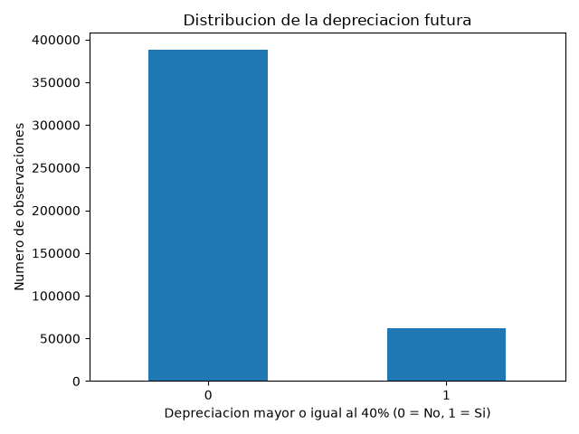
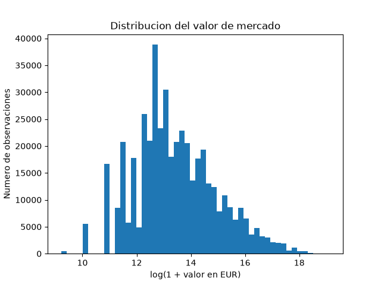
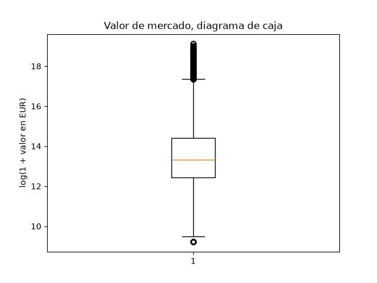
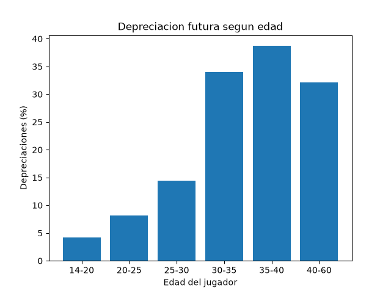
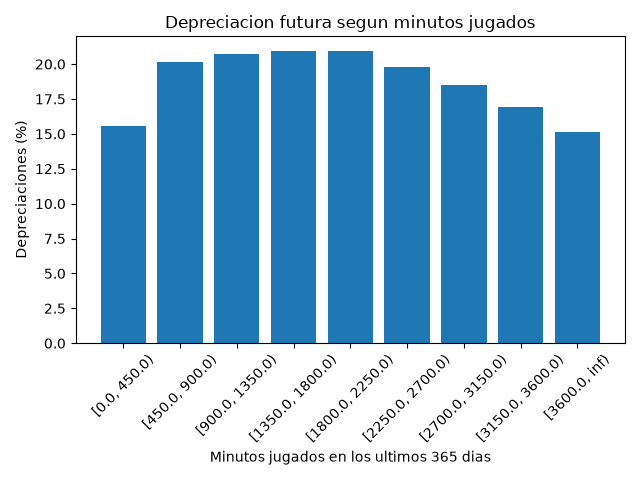
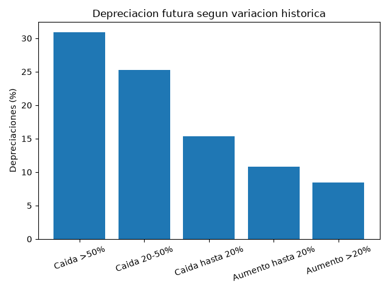

# Semana 8, Sesión 2: Exploración y visualización de datos

> Objetivo de la sesión: explorar el dataset de tu proyecto con estadística descriptiva y visualizaciones para identificar patrones, outliers y supuestos que romperían un modelo antes de entrenarlo.

**Lectura previa de esta sesión:** ["A Data Scientist's Essential Guide to Exploratory Data Analysis"](https://towardsdatascience.com/a-data-scientists-essential-guide-to-exploratory-data-analysis-25637eee0cf6/), Towards Data Science.

**Referencia de esta sesión:** [Machine Learning Zoomcamp, Módulo 1 (DataTalksClub)](https://github.com/DataTalksClub/machine-learning-zoomcamp).

## Requisitos antes de esta sesión

pandas y matplotlib ya vienen en el Codespace. En tu laptop, instálalos con `pip install -r requirements.txt` desde la raíz del repositorio. Verifica con:

```
python3 -c "import matplotlib; print(matplotlib.__version__)"
```

Los scripts de hoy guardan cada gráfico como imagen en una carpeta `figuras/`. Ábrelas desde el explorador de archivos de VS Code. También puedes correr el mismo código en un notebook de Jupyter (en el Codespace, crea un archivo `.ipynb` y elige el kernel de Python 3.11), donde el gráfico aparece debajo de la celda.

## Antes de empezar

A partir de la lectura previa:

**Según el artículo, ¿qué preguntas responde la exploración de datos antes de entrenar cualquier modelo?**

Principalmente, nos permite entender con qué datos estamos trabajando: cuántas observaciones y variables tenemos, de qué tipo son y cómo se distribuyen sus valores. También nos permite identificar posibles problemas, como datos faltantes, duplicados, valores atípicos o variables desbalanceadas, así como estudiar las relaciones y correlaciones entre ellas. A partir de estos resultados podemos determinar qué transformaciones o procesos de limpieza necesitamos aplicar y qué variables podrían ser relevantes para el modelo.

**El artículo distingue la exploración de una sola variable de la exploración de la relación entre dos. ¿Qué herramienta propone para cada una?**

Para el análisis univariado propone utilizar estadísticas descriptivas y visualizaciones de distribución, principalmente histogramas para variables numéricas y gráficos de barras para variables categóricas. Para estudiar las relaciones entre dos variables propone analizar sus interacciones mediante gráficos, como los diagramas de dispersión, y utilizar coeficientes de correlación, matrices de correlación y mapas de calor para identificar y cuantificar posibles relaciones. El artículo presenta `ydata-profiling` como una herramienta que permite automatizar estos análisis.

## Pregunta de apertura

**Entrenas un modelo que predice la tarifa de un viaje en taxi. Sin que lo sepas, 15 de los 3000 viajes tienen una tarifa de 999.99 por un error de captura. ¿Qué le pasa al modelo? ¿Lo notarías mirando solo su resultado final?**

El modelo asumiría inicialmente que esas 15 observaciones son válidas y las utilizaría durante el entrenamiento. Aunque representan apenas el 0.5% del conjunto de datos, la diferencia entre estas tarifas y las habituales podría afectar considerablemente el ajuste del modelo, especialmente si utilizamos una regresión que minimiza el error cuadrático. Esto podría provocar que el modelo sobreestime algunas tarifas, aunque el efecto dependerá del algoritmo utilizado y de la distribución de los demás datos.

Si únicamente revisamos las predicciones finales o una métrica global de rendimiento, no necesariamente identificaríamos el problema, porque estos resultados no nos indican directamente qué observaciones están causando los errores. En cambio, un análisis exploratorio de la distribución de las tarifas, sus máximos y sus valores atípicos nos permitiría detectar estas observaciones sospechosas y verificar su validez antes de entrenar el modelo.

## Ejercicio 1: resumen, distribución y atípicos

Enunciado: [`starter/viajes_taxi.csv`](./starter/viajes_taxi.csv) tiene 3000 viajes en taxi de Nueva York: fecha y hora de inicio, zona de origen y de destino, distancia, duración, pasajeros, método de pago, tarifa y propina. Primera mirada: qué contiene, cómo se distribuye la tarifa y qué valores están fuera de lo esperable.

**Respuesta 1, antes de ver la solución:** en `describe()`, ¿qué dos valores de la tabla te harían sospechar de un error sin necesidad de graficar nada?

Revisaría principalmente los valores mínimo y máximo de la tarifa. Un máximo de 999.99 resulta sospechoso para un viaje de taxi convencional, mientras que un mínimo negativo, si lo hubiera, también requeriría una explicación. Además, compararía la media con la mediana para identificar si existen valores extremos que estén alterando considerablemente el promedio.

**Respuesta 2:** la regla del IQR marca más de 300 viajes con tarifa atípica. ¿Esperas que todos sean errores? ¿Cómo lo averiguarías?

No necesariamente. La regla del IQR identifica valores alejados de la distribución habitual, pero eso no implica que sean incorrectos. Algunos podrían corresponder a viajes legítimamente largos o costosos. Para distinguirlos, examinaría su relación con otras variables, principalmente la distancia, la duración y las zonas de origen y destino. Por ejemplo, una tarifa elevada para un viaje de larga distancia podría ser razonable, mientras que una tarifa de 999.99 para un viaje de pocos minutos sería mucho más sospechosa. También revisaría si estos valores siguen algún patrón o aparecen como registros aislados antes de decidir cómo tratarlos.

**La formulación completa, tal como la resuelvo yo:**

```
import pandas as pd
import os
import matplotlib.pyplot as plt

# Crear carpeta donde yo pueda guardar todas las imagenes que vamos a generar
# se cree con el programa


output_path = 'output/ejercicio1'

os.makedirs(output_path+'/figures', exist_ok=True)

data = pd.read_csv('viajes_taxi.csv')

print("Analisis exploratorio descriptivo")

data.info()

print(data.dtypes)
print(data.isna().sum())
print(data.duplicated().sum())

print(data.describe())

plt.figure()
plt.hist(data['tarifa'], bins=50)
plt.title('Distribution de la tarifa')
plt.xlabel('USD')
plt.ylabel('Numero de viajes')
plt.savefig(output_path+'/figures/hist_tarifa.png')
plt.close()

plt.figure()
plt.boxplot(data['tarifa'])
plt.title('Boxplot de la tarifa')
plt.savefig(output_path+'/figures/boxplot_tarifa.png')
plt.close()


# Extraccion de valores atipicos

q1 = data['tarifa'].quantile(0.25)
q3 = data['tarifa'].quantile(0.75)

iqr = q3-q1
lim_sup = q3 + 1.5 * iqr
lim_inf = q1 - 1.5 * iqr


print("atipicos")
atipicos = data.query(f'tarifa < {lim_inf} or tarifa > {lim_sup}')
print(atipicos)


plt.figure()
plt.scatter(data['tarifa'], data['distancia_km'])
plt.title('Dispercion de la tarifa vs distancia_km')
plt.savefig(output_path+'/figures/scatter_distancia_vs_tarifa.png')
plt.close()


sin_atipicos = data.query(f'tarifa >= {lim_inf} and tarifa <= {lim_sup}')
plt.figure()
plt.scatter(sin_atipicos['tarifa'], sin_atipicos['distancia_km'])
plt.title('Dispercion de la tarifa vs distancia_km')
plt.savefig(output_path+'/figures/filtrado_scatter_distancia_vs_tarifa.png')
plt.close()

print(sin_atipicos.corr(numeric_only=True))

```

Output:
```

s08e1  | Analisis exploratorio descriptivo
s08e1  | <class 'pandas.DataFrame'>
s08e1  | RangeIndex: 3000 entries, 0 to 2999
s08e1  | Data columns (total 10 columns):
s08e1  |  #   Column             Non-Null Count  Dtype  
s08e1  | ---  ------             --------------  -----  
s08e1  |  0   id_viaje           3000 non-null   int64  
s08e1  |  1   fecha_hora_inicio  3000 non-null   str    
s08e1  |  2   zona_origen        3000 non-null   str    
s08e1  |  3   zona_destino       3000 non-null   str    
s08e1  |  4   distancia_km       3000 non-null   float64
s08e1  |  5   duracion_min       3000 non-null   float64
s08e1  |  6   pasajeros          2880 non-null   float64
s08e1  |  7   metodo_pago        2940 non-null   str    
s08e1  |  8   tarifa             3000 non-null   float64
s08e1  |  9   propina            3000 non-null   float64
s08e1  | dtypes: float64(5), int64(1), str(4)
s08e1  | memory usage: 234.5 KB
s08e1  | id_viaje               int64
s08e1  | fecha_hora_inicio        str
s08e1  | zona_origen              str
s08e1  | zona_destino             str
s08e1  | distancia_km         float64
s08e1  | duracion_min         float64
s08e1  | pasajeros            float64
s08e1  | metodo_pago              str
s08e1  | tarifa               float64
s08e1  | propina              float64
s08e1  | dtype: object
s08e1  | id_viaje               0
s08e1  | fecha_hora_inicio      0
s08e1  | zona_origen            0
s08e1  | zona_destino           0
s08e1  | distancia_km           0
s08e1  | duracion_min           0
s08e1  | pasajeros            120
s08e1  | metodo_pago           60
s08e1  | tarifa                 0
s08e1  | propina                0
s08e1  | dtype: int64
s08e1  | 0
s08e1  |           id_viaje  distancia_km  ...       tarifa      propina
s08e1  | count  3000.000000   3000.000000  ...  3000.000000  3000.000000
s08e1  | mean   1500.500000      8.440113  ...    31.386757     3.285143
s08e1  | std     866.169729      7.161517  ...    70.987456     3.632981
s08e1  | min       1.000000      0.000000  ...     1.600000     0.000000
s08e1  | 25%     750.750000      3.740000  ...    13.990000     0.000000
s08e1  | 50%    1500.500000      6.730000  ...    22.600000     2.480000
s08e1  | 75%    2250.250000     10.512500  ...    32.552500     4.792500
s08e1  | max    3000.000000     45.430000  ...   999.990000    17.490000
s08e1  | 
s08e1  | [8 rows x 6 columns]
s08e1  | atipicos
s08e1  |       id_viaje fecha_hora_inicio  ...  tarifa  propina
s08e1  | 2            3  2026-09-17 19:37  ...   70.00     7.46
s08e1  | 3            4  2026-10-04 18:09  ...   70.00     8.36
s08e1  | 23          24  2026-10-22 07:06  ...   70.00    15.24
s08e1  | 38          39  2026-09-23 14:46  ...   70.00     0.00
s08e1  | 40          41  2026-10-02 19:55  ...   70.00    17.49
s08e1  | ...        ...               ...  ...     ...      ...
s08e1  | 2945      2946  2026-09-10 21:53  ...   70.00     0.00
s08e1  | 2965      2966  2026-09-05 14:47  ...   70.00     0.00
s08e1  | 2973      2974  2026-10-11 14:26  ...  999.99     0.00
s08e1  | 2989      2990  2026-09-20 14:18  ...   70.00     9.97
s08e1  | 2995      2996  2026-10-11 17:06  ...   70.00    12.98
s08e1  | 
s08e1  | [334 rows x 10 columns]
s08e1  |               id_viaje  distancia_km  ...    tarifa   propina
s08e1  | id_viaje      1.000000      0.024090  ...  0.025126  0.013505
s08e1  | distancia_km  0.024090      1.000000  ...  0.970654  0.515220
s08e1  | duracion_min  0.027896      0.891807  ...  0.932089  0.497346
s08e1  | pasajeros     0.017613     -0.001143  ... -0.011372 -0.043590
s08e1  | tarifa        0.025126      0.970654  ...  1.000000  0.536329
s08e1  | propina       0.013505      0.515220  ...  0.536329  1.000000
s08e1  | 
s08e1  | [6 rows x 6 columns]
s08e1 exited with code 0

```

El conjunto contiene 3000 observaciones y 10 variables. Encontramos 120 valores faltantes en pasajeros, 60 en metodo_pago y ningún registro duplicado.

La tarifa presenta una media de 31.39 USD y una mediana de 22.60 USD, con un mínimo de 1.60 USD y un máximo de 999.99 USD. La diferencia entre media y mediana sugiere que algunos valores elevados están afectando el promedio.

Al aplicar la regla del IQR, obtuvimos un límite inferior de -13.85 USD y uno superior de 60.40 USD, identificando 334 observaciones atípicas, equivalentes al 11.13% de los viajes. Entre ellas aparecen tarifas de 70 USD y 999.99 USD. Esto muestra una limitación del método: no podemos asumir que todas son errores, pues algunas podrían corresponder a viajes legítimamente costosos.

Después de excluir estas observaciones, encontramos una correlación de Pearson de 0.971 entre distancia y tarifa, y de 0.932 entre duración y tarifa. Ambas muestran una relación lineal positiva fuerte en el conjunto filtrado. Sin embargo, estos resultados no permiten concluir que debamos eliminar definitivamente todos los valores marcados como atípicos. Primero sería necesario examinar su coherencia con las características de cada viaje.


## Durante el ConcepTest

**Tu voto, antes de discutir en pareja** (A, B, C o D):

ACTIVIDAD NO REALIZADA EN CLASE

**Tu razonamiento:**

ACTIVIDAD NO REALIZADA EN CLASE

**Después de discutir en pareja, ¿cambiaste de voto? ¿Por qué?**

ACTIVIDAD NO REALIZADA EN CLASE

## Ejercicio 2: relaciones entre variables

Solo o en pareja. Archivo: [`starter/ejercicio2_relaciones.py`](./starter/ejercicio2_relaciones.py), sobre el mismo `viajes_taxi.csv`. Quita solo los errores que el Ejercicio 1 ya confirmó y completa los 5 `TODO`: dispersión de distancia contra tarifa, propina por método de pago, correlaciones con la tarifa, y pasajeros vacíos o en 0. Al final, el script imprime una comprobación por TODO: completa los 5 hasta que todas digan `OK`.

```
python3 ejercicio2_relaciones.py
```

**Hallazgo 1: qué muestra el gráfico de distancia contra tarifa, además de la tendencia general.**

Encontramos una relación lineal positiva fuerte entre la distancia y la tarifa, con una correlación de Pearson de 0.9602. Sin embargo, el gráfico también muestra una concentración de 300 viajes con una tarifa exactamente igual a 70 USD, independientemente de su distancia, que varía entre 0 y 45.43 km. Esto sugiere que podría existir una tarifa fija, un límite aplicado al cobro o alguna particularidad en el registro de estos viajes. También observamos tarifas positivas para viajes de distancia cero, que sería necesario examinar por separado.


**Hallazgo 2: qué pasa con la propina según el método de pago, y si crees que describe a los pasajeros o al sistema que registra los datos.**

De los 888 viajes pagados en efectivo, el 100% registra una propina de cero, mientras que los 2027 viajes pagados con tarjeta presentan una propina promedio de 4.73 USD y ninguno registra propina cero. Esta diferencia tan marcada sugiere que probablemente estamos observando una característica del sistema de registro y no necesariamente del comportamiento de los pasajeros. Es posible que las propinas entregadas en efectivo no se registren, por lo que sería incorrecto concluir que estos pasajeros nunca dejan propina.

**Hallazgo 3: la duración tiene una correlación con la tarifa tan alta como la distancia. Si el modelo tiene que estimar la tarifa en el momento en que alguien pide el taxi, ¿puede usar la duración?**

La duración presenta una correlación de 0.9559 con la tarifa, muy cercana a la correlación de 0.9602 que encontramos para la distancia. Sin embargo, no podríamos utilizar la duración real del viaje para predecir la tarifa al momento de solicitarlo, porque esta información todavía no está disponible. Hacerlo introduciría una fuga de información (data leakage) al utilizar una variable que solo conoceremos después de completar el viaje. Una alternativa sería utilizar una duración estimada a partir de la ruta y las condiciones de tráfico, siempre que esa estimación esté disponible al momento de la solicitud.

## Ejercicio 3: explora el dataset de tu proyecto

```
Paso 1: resumen
Filas y columnas: (450078, 24)
PLAYER_ID                     int64
VALUATION_DATE                  str
CLUB_ID                       int64
COMPETITION_ID                  str
EDAD_ANIOS                  float64
FOOT                            str
HEIGHT_IN_CM                float64
POSITION                        str
SUB_POSITION                    str
MARKET_VALUE_IN_EUR         float64
VALOR_PREVIO_12M_EUR        float64
VARIACION_PREVIA_12M_PCT    float64
DESFASE_PREVIO_12M_DIAS     float64
PARTIDOS_180D               float64
TIENE_PARTIDOS_180D           int64
MINUTES_PLAYED_180D         float64
GOALS_180D                  float64
ASSISTS_180D                float64
PARTIDOS_365D               float64
TIENE_PARTIDOS_365D           int64
MINUTES_PLAYED_365D         float64
GOALS_365D                  float64
ASSISTS_365D                float64
TARGET_DEPRECIACION_40        int64
dtype: object
Valores faltantes:
PLAYER_ID                        0
VALUATION_DATE                   0
CLUB_ID                          0
COMPETITION_ID               67151
EDAD_ANIOS                       0
FOOT                         13583
HEIGHT_IN_CM                  7232
POSITION                         0
SUB_POSITION                   425
MARKET_VALUE_IN_EUR              0
VALOR_PREVIO_12M_EUR         94109
VARIACION_PREVIA_12M_PCT     94109
DESFASE_PREVIO_12M_DIAS      94109
PARTIDOS_180D                    0
TIENE_PARTIDOS_180D              0
MINUTES_PLAYED_180D         303984
GOALS_180D                  303984
ASSISTS_180D                303984
PARTIDOS_365D                    0
TIENE_PARTIDOS_365D              0
MINUTES_PLAYED_365D         284581
GOALS_365D                  284581
ASSISTS_365D                284581
TARGET_DEPRECIACION_40           0
dtype: int64
        PLAYER_ID    CLUB_ID  EDAD_ANIOS  HEIGHT_IN_CM  MARKET_VALUE_IN_EUR  ...  TIENE_PARTIDOS_365D  MINUTES_PLAYED_365D  GOALS_365D  ASSISTS_365D  TARGET_DEPRECIACION_40
count   450078.00  450078.00   450078.00     442846.00         4.500780e+05  ...            450078.00            165497.00   165497.00     165497.00               450078.00
mean    285027.96    6492.07       25.13        182.24         2.538137e+06  ...                 0.37              1391.14        2.04          1.60                    0.14
std     249028.62   13295.19        4.37          6.93         7.036779e+06  ...                 0.48              1051.25        3.78          2.53                    0.34
min         10.00       1.00       14.70         17.00         1.000000e+04  ...                 0.00                 1.00        0.00          0.00                    0.00
25%      78917.00     415.00       21.70        178.00         2.500000e+05  ...                 0.00               451.00        0.00          0.00                    0.00
50%     217357.00    1160.00       24.64        183.00         6.000000e+05  ...                 0.00              1245.00        1.00          1.00                    0.00
75%     413899.25    5781.00       28.12        187.00         1.800000e+06  ...                 1.00              2161.00        2.00          2.00                    0.00
max    1404902.00  133929.00       44.68        210.00         2.000000e+08  ...                 1.00              5790.00       61.00         33.00                    1.00

[8 rows x 19 columns]
Duplicados jugador-fecha: 0

Paso 2: distribucion del objetivo
TARGET_DEPRECIACION_40
0    388472
1     61606
Name: count, dtype: int64
TARGET_DEPRECIACION_40
0    86.31
1    13.69
Name: proportion, dtype: float64

Paso 3: atipicos del valor de mercado
Limite inferior: -2075000.0
Limite superior: 4125000.0
Atipicos: 56731
Porcentaje: 12.6
    MARKET_VALUE_IN_EUR  TARGET_DEPRECIACION_40
0             7000000.0                       0
2             8000000.0                       0
3            13000000.0                       0
4             9500000.0                       0
5             9500000.0                       1
6            13000000.0                       0
7             7500000.0                       1
11            5000000.0                       0
15            9500000.0                       0
18            7500000.0                       0

Paso 4: edad y depreciacion
             count  mean  porcentaje
GRUPO_EDAD                          
14-20        52513  0.04        4.18
20-25       186230  0.08        8.14
25-30       143123  0.14       14.45
30-35        60233  0.34       34.01
35-40         7764  0.39       38.70
40-60          215  0.32       32.09

Paso 5: hallazgos

Hallazgo 1: minutos jugados y depreciacion
Observaciones con minutos: 165497
                         count     mean  median
TARGET_DEPRECIACION_40                         
0                       134243  1382.44  1226.0
1                        31254  1428.48  1313.0
Correlacion minutos-target: 0.01713803535488195
                  count  mean  porcentaje
RANGO_MINUTOS                            
[0.0, 450.0)      40805  0.16       15.56
[450.0, 900.0)    24424  0.20       20.18
[900.0, 1350.0)   22631  0.21       20.72
[1350.0, 1800.0)  20939  0.21       20.94
[1800.0, 2250.0)  18540  0.21       20.91
[2250.0, 2700.0)  15834  0.20       19.79
[2700.0, 3150.0)  11615  0.19       18.50
[3150.0, 3600.0)   6644  0.17       16.92
[3600.0, inf)      4065  0.15       15.15

Hallazgo 2: variacion previa del valor
Sin variacion previa: 94109
Correlacion variacion previa-target: -0.05571550135061167
                         count  mean  porcentaje
GRUPO_VARIACION_PREVIA                          
Caida >50%               26389  0.31       30.87
Caida 20-50%             73026  0.25       25.26
Caida hasta 20%          89003  0.15       15.36
Aumento hasta 20%        27883  0.11       10.80
Aumento >20%            139668  0.08        8.48

Hallazgo 3: cobertura deportiva
TIENE_PARTIDOS_365D
0    284581
1    165497
Name: count, dtype: int64
Sin minutos: 284581
Porcentaje sin minutos: 63.23
Depreciacion por cobertura:
                      count   mean
TIENE_PARTIDOS_365D               
0                    284581  0.107
1                    165497  0.189
No tener registros de partidos no equivale a haber jugado cero minutos.
```

Usa el archivo que tu pipeline de la Semana 7 deja listo para modelar, y la plantilla [`plantilla-eda/explorar_proyecto.py`](./plantilla-eda/explorar_proyecto.py).

### Paso 0: Preparación del dataset del proyecto

Para este ejercicio utilizamos los datos de Transfermarkt que procesamos previamente mediante nuestro pipeline ELT. Partimos de tres tablas de la capa Gold, construidas durante la Semana 7:

- **`fact_player_valuation`:** contiene las valoraciones históricas de mercado de cada futbolista, identificadas por `PLAYER_ID` y `VALUATION_DATE`, junto con el valor en euros, el club y la competición correspondientes.
- **`dim_player`:** contiene información de los futbolistas, como fecha de nacimiento, posición, pie dominante y altura.
- **`fact_player_match`:** registra las participaciones de los futbolistas en partidos, incluyendo la fecha, los minutos jugados, los goles y las asistencias.

La tabla principal fue `fact_player_valuation`, con 655.695 valoraciones correspondientes a 41.494 jugadores. Decidimos utilizar cada valoración histórica como una observación, en lugar de establecer fechas de corte fijas, porque las actualizaciones de los valores de mercado no ocurren siempre en los mismos intervalos.

Primero, mediante `analizar_valuaciones_horizonte.py`, buscamos para cada valoración otra del mismo futbolista aproximadamente 12 meses después. Analizamos diferentes tolerancias temporales y escogimos **±65 días**, considerando el equilibrio entre la cantidad de observaciones recuperadas y la distancia respecto al horizonte deseado. Con esta configuración obtuvimos 450.078 observaciones con una valoración futura disponible.

Después, con `create_targets.py`, construimos la variable binaria `TARGET_DEPRECIACION_40`. Asignamos 1 cuando el valor futuro era al menos un 40% inferior al inicial y 0 en caso contrario. Las observaciones sin una valoración futura suficientemente cercana se conservaron por separado, sin asignarles una categoría artificial.

Finalmente, utilizamos `generar_dataset_modelo_gold.py` para enriquecer las observaciones etiquetadas con información de las otras tablas Gold. Calculamos la edad del futbolista en la fecha de valoración, incorporamos su posición, pie dominante y altura, y recuperamos su variación de valor durante el año anterior. También agregamos los minutos, goles, asistencias y partidos registrados durante los 180 y 365 días anteriores a cada valoración.

Todas las características históricas se calcularon utilizando únicamente información anterior a la valoración inicial. Los datos futuros se utilizaron exclusivamente para determinar la variable objetivo, evitando introducir directamente la respuesta entre las variables predictoras.

Como resultado, obtuvimos **un dataset de 450.078 filas y 24 columnas**, donde cada fila representa el estado de un futbolista en una fecha determinada y contiene la etiqueta de depreciación futura. Un mismo jugador puede aparecer varias veces porque cada valoración constituye una observación histórica diferente.

### Paso 1: resumen y variable objetivo (5 minutos)

**Reemplaza la ruta del archivo y el nombre de la columna que tu modelo va a predecir. Corre los pasos 1 a 3.**

El dataset final contiene 450.078 filas y 24 columnas. Cada fila representa una valoración histórica de un futbolista, enriquecida con sus características personales, deportivas y económicas.

La variable objetivo es TARGET_DEPRECIACION_40, que indica si el valor de mercado del jugador disminuyó al menos un 40% aproximadamente 12 meses después de la valoración inicial, utilizando una tolerancia de ±65 días.

La distribución del objetivo es de 388.472 observaciones (86,31%) para la clase 0 y 61.606 (13,69%) para la clase 1.

Los principales valores faltantes corresponden a los minutos, goles y asistencias de los últimos 365 días (284.581 filas), las estadísticas de los últimos 180 días (303.984 filas) y la variación previa del valor de mercado (94.109 filas).

Como el objetivo es binario, aplicamos el IQR al valor inicial de mercado. Se identificaron 56.731 valores atípicos (12,60%), con un límite superior de 4.125.000 EUR. Estos valores no se eliminaron porque una valoración elevada no necesariamente representa un error.






### Paso 2: relaciones (10 minutos)

Completa los pasos 4 y 5: la relación entre tu objetivo y la variable que esperas que más influya, y las consultas que confirman lo que encuentres.

Elegimos la edad del jugador (EDAD_ANIOS) como la variable que esperamos que más influya en la depreciación futura.

Agrupamos las edades en intervalos y calculamos el porcentaje de observaciones con TARGET_DEPRECIACION_40 = 1 para cada grupo.

|Edad|Depreciación ≥40%|
|--|--|
|14–20 años|4,18% |
|20–25 años|8,14%|
|25–30 años|14,45%|
|30–35 años|34,01%|
|35–40 años|38,70%|
|40–60 años|32,09%|



El gráfico de barras muestra que la frecuencia de depreciaciones aumenta considerablemente con la edad, especialmente a partir de los 30 años. El último grupo tiene solamente 215 observaciones, por lo que su resultado es menos representativo.

También realizamos consultas agrupadas y correlaciones para explorar la relación del objetivo con los minutos jugados y la variación histórica del valor.


### Paso 3: tres hallazgos que afectarían el modelado (10 minutos)

Para cada hallazgo, escribe qué encontraste, el número o el gráfico que lo confirma, y qué cambia en el modelo por su causa (una fila que quitas, una columna que no puedes usar, una variable que hay que transformar).

**Hallazgo 1:** los minutos jugados presentan una relación débil y no lineal con la depreciación.

Entre las 165.497 observaciones con minutos disponibles, la correlación entre minutos jugados en los últimos 365 días y depreciación futura fue de apenas 0,0171. Sin embargo, al agrupar los minutos encontramos tasas de depreciación del 15,56% para menos de 450 minutos, cercanas al 21% entre 900 y 2.249 minutos, y del 15,15% para más de 3.600 minutos.

Esto sugiere que la relación no es lineal. Por tanto, no eliminaremos los minutos, pero tampoco asumiremos que una mayor cantidad reduce necesariamente el riesgo. Más adelante podremos comparar modelos que capturen relaciones no lineales.



**Hallazgo 2:** la variación histórica del valor está asociada con la depreciación futura.

Los jugadores cuyo valor había disminuido más del 50% durante el año anterior presentaron una tasa de depreciación futura del 30,87%, mientras que aquellos cuyo valor había aumentado más del 20% presentaron una tasa del 8,48%.

Esto sugiere que las tendencias previas podrían aportar información predictiva. Conservaremos VARIACION_PREVIA_12M_PCT como característica del modelo, pero tendremos que gestionar sus 94.109 valores faltantes durante el preprocesamiento.



**Hallazgo 3:** existe una cobertura limitada de estadísticas deportivas.

Encontramos que 284.581 observaciones (63,23%) no tienen minutos registrados durante los 365 días anteriores. Además, la tasa de depreciación fue del 10,67% entre las observaciones sin registros deportivos y del 18,88% entre las que sí cuentan con ellos.

Esta diferencia indica que los grupos podrían tener características distintas. No podemos interpretar la ausencia de registros como cero minutos jugados.

Por ello, mantendremos los valores faltantes y la columna TIENE_PARTIDOS_365D para distinguir la disponibilidad de información deportiva. En los siguientes ejercicios evaluaremos cómo imputar estas variables sin perder una parte importante del dataset.

```
Hallazgo 3: cobertura deportiva
TIENE_PARTIDOS_365D
0    284581
1    165497
Name: count, dtype: int64
Sin minutos: 284581
Porcentaje sin minutos: 63.23
Depreciacion por cobertura:
                      count   mean
TIENE_PARTIDOS_365D               
0                    284581  0.107
1                    165497  0.189
No tener registros de partidos no equivale a haber jugado cero minutos.
```

## Antes de la próxima sesión

**Lectura:** ["Feature Engineering that Makes Business Sense"](https://towardsdatascience.com/feature-engineering-that-makes-business-sense-419b9403236e/), Towards Data Science.

La tarifa fija de JFK y la hora del día no existen como columnas del dataset de taxis. ¿Cómo le darías esa información a un modelo?

_(tu respuesta)_
