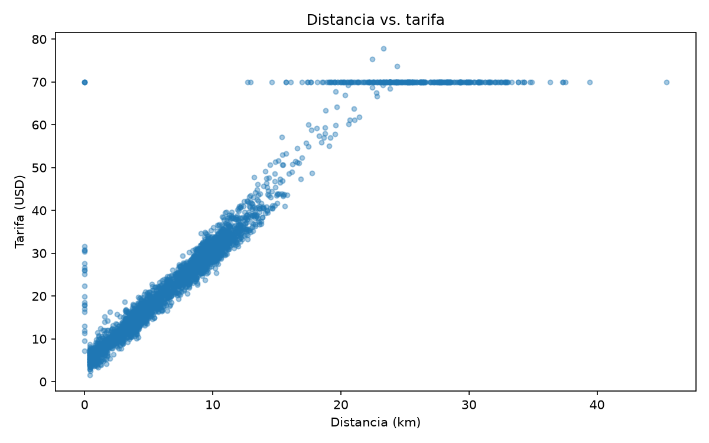

# Semana 8, Sesión 2: Exploración y visualización de datos

> Objetivo de la sesión: explorar el dataset de tu proyecto con estadística descriptiva y visualizaciones para identificar patrones, outliers y supuestos que romperían un modelo antes de entrenarlo.

**Lectura previa de esta sesión:** ["A Data Scientist's Essential Guide to Exploratory Data Analysis"](https://towardsdatascience.com/a-data-scientists-essential-guide-to-exploratory-data-analysis-25637eee0cf6/), Towards Data Science.

**Referencia de esta sesión:** [Machine Learning Zoomcamp, Módulo 1 (DataTalksClub)](https://github.com/DataTalksClub/machine-learning-zoomcamp).

## Requisitos antes de esta sesión

pandas y matplotlib ya vienen en el Codespace. En tu laptop, instálalos con `pip install -r requirements.txt` desde la raíz del repositorio. Verifica con:

```
python3 -c "import matplotlib; print(matplotlib.__version__)"
```

Los scripts de hoy guardan cada gráfico como imagen en una carpeta `figuras/`. Ábrelas desde el explorador de archivos de VS Code. También puedes correr el mismo código en un notebook de Jupyter (en el Codespace, crea un archivo `.ipynb` y elige el kernel de Python 3.11), donde el gráfico aparece debajo de la celda.

## Antes de empezar

A partir de la lectura previa:

**Según el artículo, ¿qué preguntas responde la exploración de datos antes de entrenar cualquier modelo?**

Principalmente, nos permite entender con qué datos estamos trabajando: cuántas observaciones y variables tenemos, de qué tipo son y cómo se distribuyen sus valores. También nos permite identificar posibles problemas, como datos faltantes, duplicados, valores atípicos o variables desbalanceadas, así como estudiar las relaciones y correlaciones entre ellas. A partir de estos resultados podemos determinar qué transformaciones o procesos de limpieza necesitamos aplicar y qué variables podrían ser relevantes para el modelo.

**El artículo distingue la exploración de una sola variable de la exploración de la relación entre dos. ¿Qué herramienta propone para cada una?**

Para el análisis univariado propone utilizar estadísticas descriptivas y visualizaciones de distribución, principalmente histogramas para variables numéricas y gráficos de barras para variables categóricas. Para estudiar las relaciones entre dos variables propone analizar sus interacciones mediante gráficos, como los diagramas de dispersión, y utilizar coeficientes de correlación, matrices de correlación y mapas de calor para identificar y cuantificar posibles relaciones. El artículo presenta `ydata-profiling` como una herramienta que permite automatizar estos análisis.

## Pregunta de apertura

**Entrenas un modelo que predice la tarifa de un viaje en taxi. Sin que lo sepas, 15 de los 3000 viajes tienen una tarifa de 999.99 por un error de captura. ¿Qué le pasa al modelo? ¿Lo notarías mirando solo su resultado final?**

El modelo asumiría inicialmente que esas 15 observaciones son válidas y las utilizaría durante el entrenamiento. Aunque representan apenas el 0.5% del conjunto de datos, la diferencia entre estas tarifas y las habituales podría afectar considerablemente el ajuste del modelo, especialmente si utilizamos una regresión que minimiza el error cuadrático. Esto podría provocar que el modelo sobreestime algunas tarifas, aunque el efecto dependerá del algoritmo utilizado y de la distribución de los demás datos.

Si únicamente revisamos las predicciones finales o una métrica global de rendimiento, no necesariamente identificaríamos el problema, porque estos resultados no nos indican directamente qué observaciones están causando los errores. En cambio, un análisis exploratorio de la distribución de las tarifas, sus máximos y sus valores atípicos nos permitiría detectar estas observaciones sospechosas y verificar su validez antes de entrenar el modelo.

## Ejercicio 1: resumen, distribución y atípicos

Enunciado: [`starter/viajes_taxi.csv`](./starter/viajes_taxi.csv) tiene 3000 viajes en taxi de Nueva York: fecha y hora de inicio, zona de origen y de destino, distancia, duración, pasajeros, método de pago, tarifa y propina. Primera mirada: qué contiene, cómo se distribuye la tarifa y qué valores están fuera de lo esperable.

**Respuesta 1, antes de ver la solución:** en `describe()`, ¿qué dos valores de la tabla te harían sospechar de un error sin necesidad de graficar nada?

Revisaría principalmente los valores mínimo y máximo de la tarifa. Un máximo de 999.99 resulta sospechoso para un viaje de taxi convencional, mientras que un mínimo negativo, si lo hubiera, también requeriría una explicación. Además, compararía la media con la mediana para identificar si existen valores extremos que estén alterando considerablemente el promedio.

**Respuesta 2:** la regla del IQR marca más de 300 viajes con tarifa atípica. ¿Esperas que todos sean errores? ¿Cómo lo averiguarías?

No necesariamente. La regla del IQR identifica valores alejados de la distribución habitual, pero eso no implica que sean incorrectos. Algunos podrían corresponder a viajes legítimamente largos o costosos. Para distinguirlos, examinaría su relación con otras variables, principalmente la distancia, la duración y las zonas de origen y destino. Por ejemplo, una tarifa elevada para un viaje de larga distancia podría ser razonable, mientras que una tarifa de 999.99 para un viaje de pocos minutos sería mucho más sospechosa. También revisaría si estos valores siguen algún patrón o aparecen como registros aislados antes de decidir cómo tratarlos.

**La formulación completa, tal como la resuelvo yo:**

```
import pandas as pd
import os
import matplotlib.pyplot as plt

# Crear carpeta donde yo pueda guardar todas las imagenes que vamos a generar
# se cree con el programa

os.makedirs('figures', exist_ok=True)

localdir = "starter"

data = pd.read_csv(localdir+'/viajes_taxi.csv')

print("Analisis exploratorio descriptivo")

data.info()

print(data.dtypes)
print(data.isna().sum())
print(data.duplicated().sum())

print(data.describe())

plt.figure()
plt.hist(data['tarifa'], bins=50)
plt.title('Distribution de la tarifa')
plt.xlabel('USD')
plt.ylabel('Numero de viajes')
plt.savefig(localdir+'/figures/hist_tarifa.png')
plt.close()

plt.figure()
plt.boxplot(data['tarifa'])
plt.title('Boxplot de la tarifa')
plt.savefig('./starter/figures/boxplot_tarifa.png')
plt.close()


# Extraccion de valores atipicos

q1 = data['tarifa'].quantile(0.25)
q3 = data['tarifa'].quantile(0.75)

iqr = q3-q1
lim_sup = q3 + 1.5 * iqr
lim_inf = q1 - 1.5 * iqr


print("atipicos")
atipicos = data.query(f'tarifa < {lim_inf} or tarifa > {lim_sup}')
print(atipicos)


plt.figure()
plt.scatter(data['tarifa'], data['distancia_km'])
plt.title('Dispercion de la tarifa vs distancia_km')
plt.savefig('./starter/figures/scatter_distancia_vs_tarifa.png')
plt.close()


sin_atipicos = data.query(f'tarifa >= {lim_inf} and tarifa <= {lim_sup}')
plt.figure()
plt.scatter(sin_atipicos['tarifa'], sin_atipicos['distancia_km'])
plt.title('Dispercion de la tarifa vs distancia_km')
plt.savefig('./starter/figures/filtrado_scatter_distancia_vs_tarifa.png')
plt.close()

print(sin_atipicos.corr(numeric_only=True))

```

Output:
```
s8e1  | Analisis exploratorio descriptivo
s8e1  | <class 'pandas.DataFrame'>
s8e1  | RangeIndex: 3000 entries, 0 to 2999
s8e1  | Data columns (total 10 columns):
s8e1  |  #   Column             Non-Null Count  Dtype  
s8e1  | ---  ------             --------------  -----  
s8e1  |  0   id_viaje           3000 non-null   int64  
s8e1  |  1   fecha_hora_inicio  3000 non-null   str    
s8e1  |  2   zona_origen        3000 non-null   str    
s8e1  |  3   zona_destino       3000 non-null   str    
s8e1  |  4   distancia_km       3000 non-null   float64
s8e1  |  5   duracion_min       3000 non-null   float64
s8e1  |  6   pasajeros          2880 non-null   float64
s8e1  |  7   metodo_pago        2940 non-null   str    
s8e1  |  8   tarifa             3000 non-null   float64
s8e1  |  9   propina            3000 non-null   float64
s8e1  | dtypes: float64(5), int64(1), str(4)
s8e1  | memory usage: 234.5 KB
s8e1  | id_viaje               int64
s8e1  | fecha_hora_inicio        str
s8e1  | zona_origen              str
s8e1  | zona_destino             str
s8e1  | distancia_km         float64
s8e1  | duracion_min         float64
s8e1  | pasajeros            float64
s8e1  | metodo_pago              str
s8e1  | tarifa               float64
s8e1  | propina              float64
s8e1  | dtype: object
s8e1  | id_viaje               0
s8e1  | fecha_hora_inicio      0
s8e1  | zona_origen            0
s8e1  | zona_destino           0
s8e1  | distancia_km           0
s8e1  | duracion_min           0
s8e1  | pasajeros            120
s8e1  | metodo_pago           60
s8e1  | tarifa                 0
s8e1  | propina                0
s8e1  | dtype: int64
s8e1  | 0
s8e1  |           id_viaje  distancia_km  ...       tarifa      propina
s8e1  | count  3000.000000   3000.000000  ...  3000.000000  3000.000000
s8e1  | mean   1500.500000      8.440113  ...    31.386757     3.285143
s8e1  | std     866.169729      7.161517  ...    70.987456     3.632981
s8e1  | min       1.000000      0.000000  ...     1.600000     0.000000
s8e1  | 25%     750.750000      3.740000  ...    13.990000     0.000000
s8e1  | 50%    1500.500000      6.730000  ...    22.600000     2.480000
s8e1  | 75%    2250.250000     10.512500  ...    32.552500     4.792500
s8e1  | max    3000.000000     45.430000  ...   999.990000    17.490000
s8e1  | 
s8e1  | [8 rows x 6 columns]
s8e1  | atipicos
s8e1  |       id_viaje fecha_hora_inicio      zona_origen  ... metodo_pago  tarifa  propina
s8e1  | 2            3  2026-09-17 19:37  Upper East Side  ...     tarjeta   70.00     7.46
s8e1  | 3            4  2026-10-04 18:09           Harlem  ...     tarjeta   70.00     8.36
s8e1  | 23          24  2026-10-22 07:06  Upper East Side  ...     tarjeta   70.00    15.24
s8e1  | 38          39  2026-09-23 14:46  Upper East Side  ...    efectivo   70.00     0.00
s8e1  | 40          41  2026-10-02 19:55          Midtown  ...     tarjeta   70.00    17.49
s8e1  | ...        ...               ...              ...  ...         ...     ...      ...
s8e1  | 2945      2946  2026-09-10 21:53      JFK Airport  ...    efectivo   70.00     0.00
s8e1  | 2965      2966  2026-09-05 14:47      JFK Airport  ...    efectivo   70.00     0.00
s8e1  | 2973      2974  2026-10-11 14:26          Midtown  ...    efectivo  999.99     0.00
s8e1  | 2989      2990  2026-09-20 14:18      JFK Airport  ...     tarjeta   70.00     9.97
s8e1  | 2995      2996  2026-10-11 17:06      JFK Airport  ...     tarjeta   70.00    12.98
s8e1  | 
s8e1  | [334 rows x 10 columns]
s8e1  |               id_viaje  distancia_km  ...    tarifa   propina
s8e1  | id_viaje      1.000000      0.024090  ...  0.025126  0.013505
s8e1  | distancia_km  0.024090      1.000000  ...  0.970654  0.515220
s8e1  | duracion_min  0.027896      0.891807  ...  0.932089  0.497346
s8e1  | pasajeros     0.017613     -0.001143  ... -0.011372 -0.043590
s8e1  | tarifa        0.025126      0.970654  ...  1.000000  0.536329
s8e1  | propina       0.013505      0.515220  ...  0.536329  1.000000
s8e1  | 
s8e1  | [6 rows x 6 columns]

```

El conjunto contiene 3000 observaciones y 10 variables. Encontramos 120 valores faltantes en pasajeros, 60 en metodo_pago y ningún registro duplicado.

La tarifa presenta una media de 31.39 USD y una mediana de 22.60 USD, con un mínimo de 1.60 USD y un máximo de 999.99 USD. La diferencia entre media y mediana sugiere que algunos valores elevados están afectando el promedio.

Al aplicar la regla del IQR, obtuvimos un límite inferior de -13.85 USD y uno superior de 60.40 USD, identificando 334 observaciones atípicas, equivalentes al 11.13% de los viajes. Entre ellas aparecen tarifas de 70 USD y 999.99 USD. Esto muestra una limitación del método: no podemos asumir que todas son errores, pues algunas podrían corresponder a viajes legítimamente costosos.

Después de excluir estas observaciones, encontramos una correlación de Pearson de 0.971 entre distancia y tarifa, y de 0.932 entre duración y tarifa. Ambas muestran una relación lineal positiva fuerte en el conjunto filtrado. Sin embargo, estos resultados no permiten concluir que debamos eliminar definitivamente todos los valores marcados como atípicos. Primero sería necesario examinar su coherencia con las características de cada viaje.


## Durante el ConcepTest

**Tu voto, antes de discutir en pareja** (A, B, C o D):

ACTIVIDAD NO REALIZADA EN CLASE

**Tu razonamiento:**

ACTIVIDAD NO REALIZADA EN CLASE

**Después de discutir en pareja, ¿cambiaste de voto? ¿Por qué?**

ACTIVIDAD NO REALIZADA EN CLASE

## Ejercicio 2: relaciones entre variables

Solo o en pareja. Archivo: [`starter/ejercicio2_relaciones.py`](./starter/ejercicio2_relaciones.py), sobre el mismo `viajes_taxi.csv`. Quita solo los errores que el Ejercicio 1 ya confirmó y completa los 5 `TODO`: dispersión de distancia contra tarifa, propina por método de pago, correlaciones con la tarifa, y pasajeros vacíos o en 0. Al final, el script imprime una comprobación por TODO: completa los 5 hasta que todas digan `OK`.

```
python3 ejercicio2_relaciones.py
```

**Hallazgo 1: qué muestra el gráfico de distancia contra tarifa, además de la tendencia general.**

Encontramos una relación lineal positiva fuerte entre la distancia y la tarifa, con una correlación de Pearson de 0.9602. Sin embargo, el gráfico también muestra una concentración de 300 viajes con una tarifa exactamente igual a 70 USD, independientemente de su distancia, que varía entre 0 y 45.43 km. Esto sugiere que podría existir una tarifa fija, un límite aplicado al cobro o alguna particularidad en el registro de estos viajes. También observamos tarifas positivas para viajes de distancia cero, que sería necesario examinar por separado.



**Hallazgo 2: qué pasa con la propina según el método de pago, y si crees que describe a los pasajeros o al sistema que registra los datos.**

De los 888 viajes pagados en efectivo, el 100% registra una propina de cero, mientras que los 2027 viajes pagados con tarjeta presentan una propina promedio de 4.73 USD y ninguno registra propina cero. Esta diferencia tan marcada sugiere que probablemente estamos observando una característica del sistema de registro y no necesariamente del comportamiento de los pasajeros. Es posible que las propinas entregadas en efectivo no se registren, por lo que sería incorrecto concluir que estos pasajeros nunca dejan propina.

**Hallazgo 3: la duración tiene una correlación con la tarifa tan alta como la distancia. Si el modelo tiene que estimar la tarifa en el momento en que alguien pide el taxi, ¿puede usar la duración?**

La duración presenta una correlación de 0.9559 con la tarifa, muy cercana a la correlación de 0.9602 que encontramos para la distancia. Sin embargo, no podríamos utilizar la duración real del viaje para predecir la tarifa al momento de solicitarlo, porque esta información todavía no está disponible. Hacerlo introduciría una fuga de información (data leakage) al utilizar una variable que solo conoceremos después de completar el viaje. Una alternativa sería utilizar una duración estimada a partir de la ruta y las condiciones de tráfico, siempre que esa estimación esté disponible al momento de la solicitud.

## Ejercicio 3: explora el dataset de tu proyecto

Usa el archivo que tu pipeline de la Semana 7 deja listo para modelar, y la plantilla [`plantilla-eda/explorar_proyecto.py`](./plantilla-eda/explorar_proyecto.py).

### Paso 1: resumen y variable objetivo (5 minutos)

Reemplaza la ruta del archivo y el nombre de la columna que tu modelo va a predecir. Corre los pasos 1 a 3.

_(filas, columnas, faltantes por columna, y cuántos atípicos marcó el IQR en tu objetivo)_

### Paso 2: relaciones (10 minutos)

Completa los pasos 4 y 5: la relación entre tu objetivo y la variable que esperas que más influya, y las consultas que confirman lo que encuentres.

_(qué gráfico o consulta hiciste, y qué mostró)_

### Paso 3: tres hallazgos que afectarían el modelado (10 minutos)

Para cada hallazgo, escribe qué encontraste, el número o el gráfico que lo confirma, y qué cambia en el modelo por su causa (una fila que quitas, una columna que no puedes usar, una variable que hay que transformar).

**Hallazgo 1:**

_(tu hallazgo)_

**Hallazgo 2:**

_(tu hallazgo)_

**Hallazgo 3:**

_(tu hallazgo)_

## Antes de la próxima sesión

**Lectura:** ["Feature Engineering that Makes Business Sense"](https://towardsdatascience.com/feature-engineering-that-makes-business-sense-419b9403236e/), Towards Data Science.

La tarifa fija de JFK y la hora del día no existen como columnas del dataset de taxis. ¿Cómo le darías esa información a un modelo?

_(tu respuesta)_
